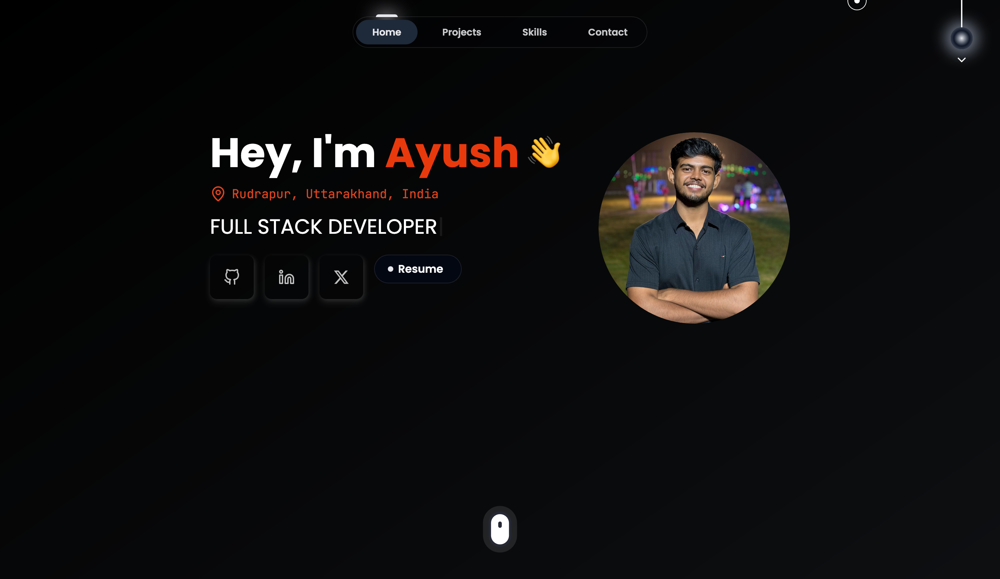

# 🚀 Chhalak Kumar — Developer Portfolio

Welcome to my portfolio website:  
🌐 **Live Demo : [Coming Soon]**  
This site showcases my journey as a Full Stack Developer, MERN Stack specialist, and AI/ML enthusiast.



---

## 📌 About Me

Hey, I'm **Chhalak Kumar**, currently pursuing B.Tech in Information Technology at **IIIT Una**. I specialize in full-stack development with the MERN stack and have a strong passion for AI/ML and GenAI technologies. I've worked as a Full Stack Developer Intern at Modelsuite.ai, contributing to workforce management platforms and building scalable web applications.

I'm also the Football Council Head at Zenith Sports Club, IIIT Una, where I lead the college football team and manage operations for 20+ players.

---

## 🛠️ Tech Stack

**Frontend:** React.js, Next.js, TypeScript, JavaScript, Tailwind CSS, HTML5, CSS3  
**Backend:** Node.js, Express.js, FastAPI, Python  
**Databases:** MongoDB, PostgreSQL, Redis  
**AI/ML:** PyTorch, scikit-learn, NumPy, pandas, Hugging Face Transformers  
**GenAI:** LangChain, LangGraph, Google Gemini API, RAG, FAISS, Embeddings, Vector Databases  
**Cloud & Tools:** AWS EC2, Docker, Nginx, Git, GitHub, Firebase, Postman  
**Fundamentals:** Data Structures & Algorithms (1850+ LeetCode rating), OOP, DBMS, OS

---

## ✨ Key Features

- 🌓 **Dark / Light Mode** with interactive pull-down theme switcher
- ⚡ Smooth scroll navigation with active section highlighting
- 🎨 **Neumorphic Design** with gradient project cards
- 🎯 **Custom Cursor** with smooth tracking animation
- ✨ **Animated Components** with Framer Motion
- 📩 Working **Contact Form** via EmailJS
- 💼 Interactive project modals with 3D tilt effects
- 🏆 **26 Tech Skills** displayed with hover animations

---

## 🚀 Featured Projects

### DevGrams
A developer networking platform with real-time chat, JWT authentication, and payment integration (Razorpay). Deployed on AWS EC2 with Nginx reverse proxy.

**Tech:** React, Node.js, Express, MongoDB, Socket.io, AWS EC2  
**Live:** [devgrams.in](https://devgrams.in)

### AgroConnect
Full-stack crop trading platform with farmer/buyer portals, real-time inventory updates via Socket.io, and AI crop prediction using Google Gemini.

**Tech:** React, Node.js, Express, MongoDB, Socket.io, Gemini API

### StackAssist AI
RAG-based developer knowledge assistant using LangChain, FAISS vector database, and Google Gemini. Features hybrid retrieval combining semantic and keyword search.

**Tech:** Python, LangChain, FAISS, Streamlit, Google Gemini

---

## 🧪 Running Locally

```bash
git clone https://github.com/Chhalakumar/portfolio.git
cd portfolio
npm install
npm run dev
```

> Add environment variables in `.env.local` for EmailJS:

```env
NEXT_PUBLIC_EMAILJS_SERVICE_ID=your_service_id
NEXT_PUBLIC_EMAILJS_TEMPLATE_ID=your_template_id
NEXT_PUBLIC_EMAILJS_PUBLIC_KEY=your_public_key
```

---

## 📬 Contact Me

* 📩 Email: [chhalakumariiitu@gmail.com](mailto:chhalakumariiitu@gmail.com)
* 🔗 [LinkedIn](https://linkedin.com/in/chhalak-kumar-98917627a)
* 💻 [GitHub](https://github.com/chhalakumar)
* 📱 Phone: +91-9977319968

---

## 🏆 Achievements

* **LeetCode Knight** — 1850+ rating, 300+ problems solved
* **Semi-finalist** — HackVega 2.0 National Hackathon
* **Semi-finalist** — Flipkart GRiD 8.0 Software Engineering Competition
* **Football Council Head** — Zenith Sports Club, IIIT Una (2026-Present)

---

## 💼 Experience

**Full Stack Developer Intern** — Modelsuite.ai (Germany-based startup)  
*Feb 2026 - April 2026*

- Worked on workforce management platform serving 100+ employees
- Built meeting management, announcements, task management, and leave management modules
- Merged 50+ PRs in a 25-engineer Agile team using Git-based development

---

## 📄 License

This project is open source. Feel free to fork and customize it for your own use.

---

> Built with Next.js 15, TypeScript, and Tailwind CSS. Deployed on Vercel.
